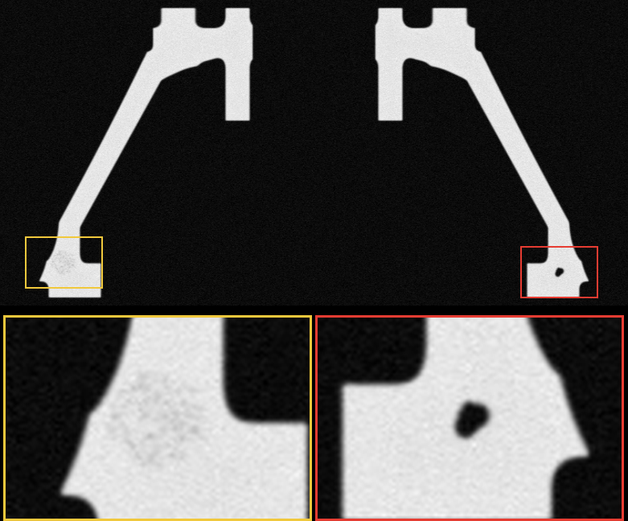
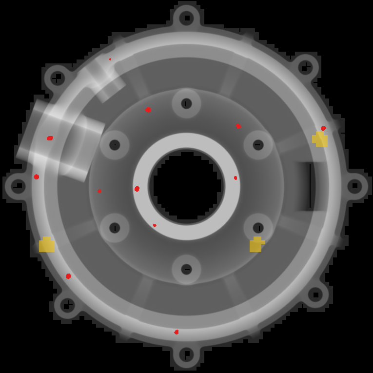
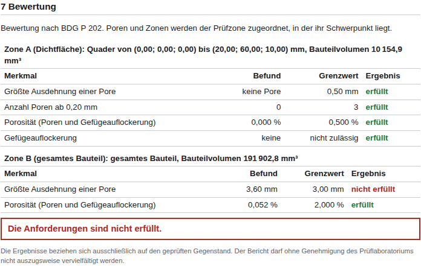
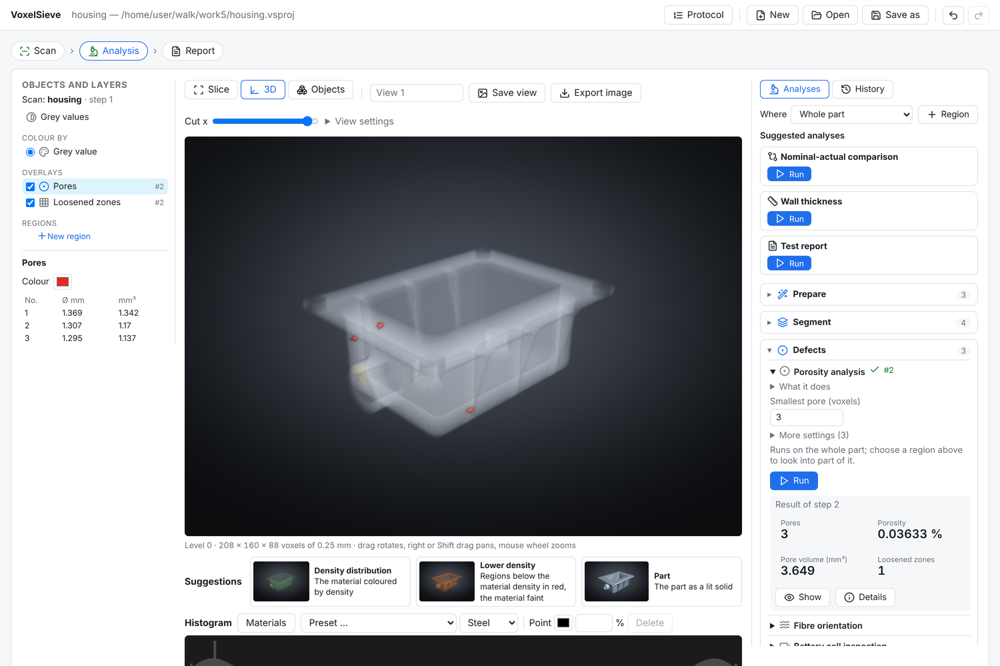

# VoxelSieve

Open-source tooling for industrial CT volumes, built on [OpenVDB](https://www.openvdb.org/).

Reconstructed CT volumes are large, uncompressed raw files in which most voxels are air.
VoxelSieve separates the surrounding air from the part, keeps internal voids such as pores,
and stores the result as a sparse, bricked VDB dataset that works for scans larger than memory.
On top of it, it finds pores and loosened microstructure and writes an inspection report.

| CT slice | Porosity analysis | Inspection report |
|---|---|---|
|  |  |  |
| Section through a synthetic scan of a bell housing: a loosened zone and a shrinkage cavity in the engine flange | `vs-porosity`: pores in red, loosened zones in yellow | `vs-report`: evaluation per inspection zone (BDG P 202 and P 203 schemes) |

The images come from a synthetic scan of a cast bell housing whose defects are known, so every
result is checked against the ground truth ([how it is made](docs/synthetic.md#the-bell-housing-of-the-readme)).

Status: early development. The latest release is
[0.7.0](https://github.com/yoshi5534/VoxelSieve/releases/latest); what has changed since is under
"Unreleased" in the [changelog](CHANGELOG.md). Website: https://yoshi5534.github.io/VoxelSieve/

## What it does

- **Import** raw volumes (with vendor headers, or none: size and type are read from the name or
  the grey values; also signed, 32-bit and float samples), TIFF, PNG and DICOM stacks, also in ZIP
  archives, MetaImage, NRRD, HDF5/NeXus and DICONDE. Scans of hundreds of
  GB are streamed out of core within a memory budget; an interrupted import resumes.
- **Porosity** with pores and loosened microstructure, evaluated per inspection zone after
  BDG P 202 or with the porosity key of the drawing after BDG P 203, in an inspection report.
- **Geometry**: nominal-actual comparison with the CAD model (also non-rigid), wall thickness,
  dimensional measurement with datums and tolerances, and first article reports.
- **More**: material segmentation (by grey value or a learned model), denoising, beam hardening
  correction, fibre orientation of composites, battery cell inspection, regions of a scan.
- **Browser UI**: open a scan in one step, a workspace with layers for slice and 3D view, colour
  maps, lighting, looks and video export, undo and redo for every step.
- **AI assistants**: an MCP server, so an assistant such as Claude runs the analyses on your
  computer; a [Claude Code plugin](https://github.com/yoshi5534/voxelsieve-plugin) adds skills
  for the common inspections.
- **Python**: numpy access to datasets of any size and every operation (`import voxelsieve`).



## Get started

Download a package from the [latest release](https://github.com/yoshi5534/VoxelSieve/releases/latest):
an MCP bundle (`.mcpb`) for Claude Desktop, or an archive with all tools for Linux (x64), Windows
(x64) and macOS (Apple silicon). The Docker image is `ghcr.io/yoshi5534/voxelsieve`, and Python
wheels are attached to the release. The [quickstart](docs/quickstart.md) takes you from download
to a porosity report and a CAD comparison on sample data in about ten minutes.

```sh
vs-gui                                    # browser UI at http://localhost:8410
vs-gui --mcp ~/scans                      # MCP server for an AI assistant, data in ~/scans
vs-sieve scan.raw --out scan.vsieve       # import on the command line
vs-report scan.vsieve --order examples/inspection_order.json --out scan.report
```

## Tools

| Tool | Does |
|---|---|
| `vs-gui` | browser UI: open a scan, analyses beside slice and 3D view with layers, undo; `--mcp` serves it to AI assistants |
| `vs-sieve` | raw, MetaImage, NRRD or HDF5 volume, TIFF, PNG or DICOM stack → sparse bricked dataset, streamed, out of core |
| `vs-porosity` | pores and loosened zones → JSON, projection images, VDB for Blender or Houdini |
| `vs-report` | porosity analysis + acceptance limits → inspection report (HTML, print to PDF) |
| `vs-surface` | dataset → surface as a compact distance mask, mesh or VDB level set |
| `vs-compare` | surface + CAD model (STL) → aligned nominal-actual deviation, statistics, coloured PLY |
| `vs-thickness` | dataset → wall thickness on the surface (ray or sphere) and inside the part, thin and thick regions |
| `vs-segment` | dataset → material classes by grey value or a learned model, scored against labels |
| `vs-denoise` | dataset → denoised dataset (non-local means or a learned model) |
| `vs-beam-hardening` | dataset → dataset without cupping and streaks from beam hardening |
| `vs-battery` | battery cell → housing, electrode layers, anode overhang, particles, voids, report |
| `vs-diconde` | dataset + pores + materials + inspection order → DICONDE series |
| `vs-synth` | STL mesh → synthetic CT scan with defects, noise and artefacts, plus ground truth |
| `vs-phantom` | simple box phantom with analytic ground truth |

Every tool takes `--memory`, `--cache` and `--threads` and explains itself with `--help`.

## Documentation

| Page | Contents |
|---|---|
| [Quickstart](docs/quickstart.md) | from download to a report with an AI assistant, on sample data |
| [Importing scans](docs/import.md) | the bricked dataset, raw, TIFF, MetaImage, NRRD, PNG, HDF5, DICOM and DICONDE input, the first look, reading datasets from C++ |
| [Analyses](docs/analyses.md) | surface, nominal-actual, wall thickness, porosity, dimensional measurement, battery cells, materials, denoising, beam hardening, fibres, regions |
| [Inspection report](docs/report.md) | orders, acceptance limits after BDG P 202 and P 203, templates |
| [Browser UI](docs/gui.md) | opening a scan, the workspace and its layers, slice and 3D view, objects and alignment |
| [AI assistants over MCP](docs/mcp.md) | packages, registering the server, tools, resources and prompts |
| [Python](docs/python.md) | the `voxelsieve` package |
| [Projects, operations and plugins](docs/library.md) | the C++ library, projects with undo, writing a plugin |
| [Synthetic scans](docs/synthetic.md) | test scans with defects and ground truth |
| [Architecture decisions](docs/adr) | why things are the way they are |

## Build

Dependencies come from [vcpkg](https://vcpkg.io), pinned in `vcpkg.json`. On Ubuntu 24.04:

```sh
sudo apt-get install cmake ninja-build g++ git curl zip unzip tar autoconf automake libtool pkg-config
tools/setup-vcpkg.sh && export VCPKG_ROOT=~/vcpkg
cmake --preset release && cmake --build --preset release && ctest --preset release
./build/release/apps/vs-phantom/vs-phantom --out phantom --dims 256
```

The first configure builds OpenVDB, Boost and TBB from source, which takes a while; vcpkg keeps
the result in its binary cache for later builds. A build directory configured before the switch
to vcpkg needs `cmake --preset release --fresh`.

On Windows (x64, the MSVC 2022 build tools with the C++ workload, from a Developer PowerShell
with Git Bash on the PATH) and macOS (Apple silicon, Xcode command line tools plus
`brew install ninja autoconf autoconf-archive automake libtool pkg-config`), use the preset
`windows` or `macos` instead of `release`. On Windows the programs land in `build/windows/bin`.
The Python package builds with `pip install .` ([docs/python.md](docs/python.md)).

## Contributing

See [CONTRIBUTING.md](CONTRIBUTING.md). Commits are signed off under the Developer Certificate of
Origin.

## License

Apache-2.0, see [LICENSE](LICENSE). Third-party libraries and their licenses are listed in
[NOTICE](NOTICE).
