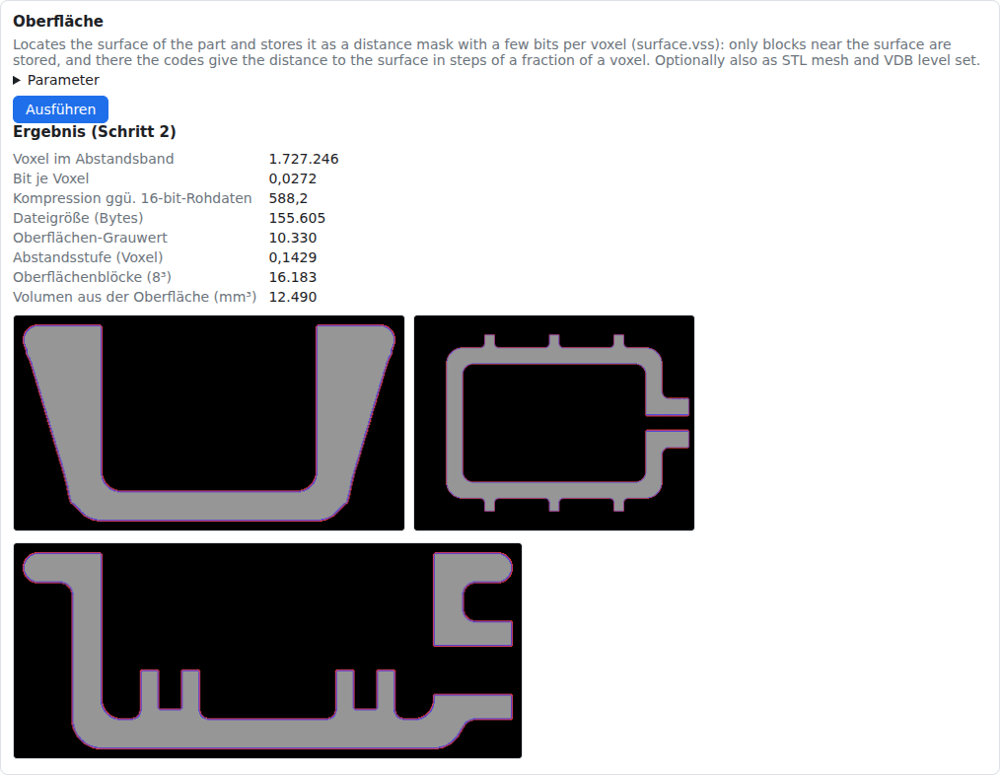
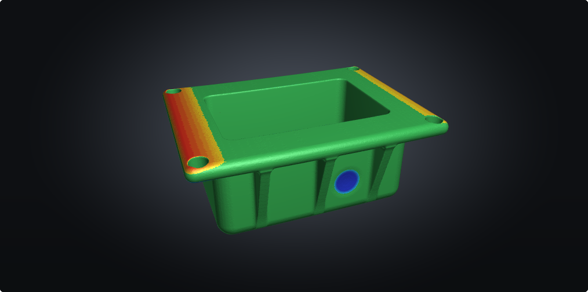
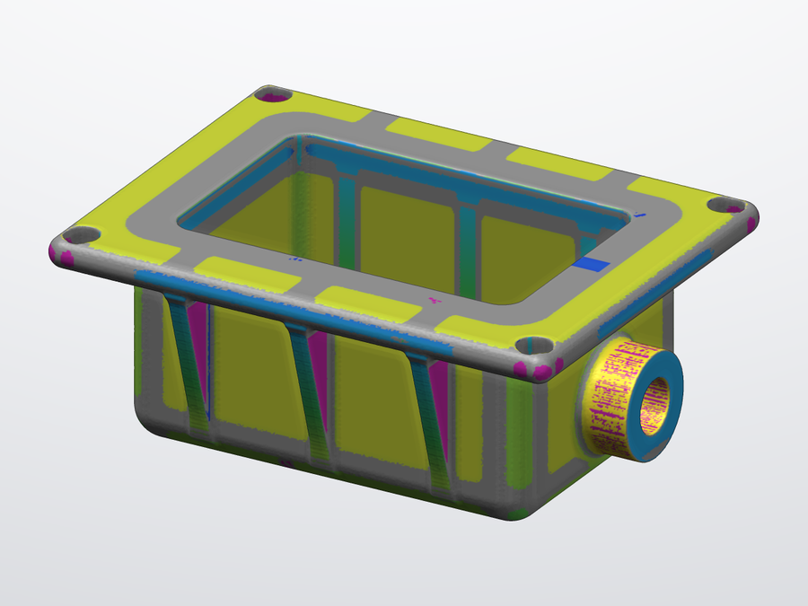
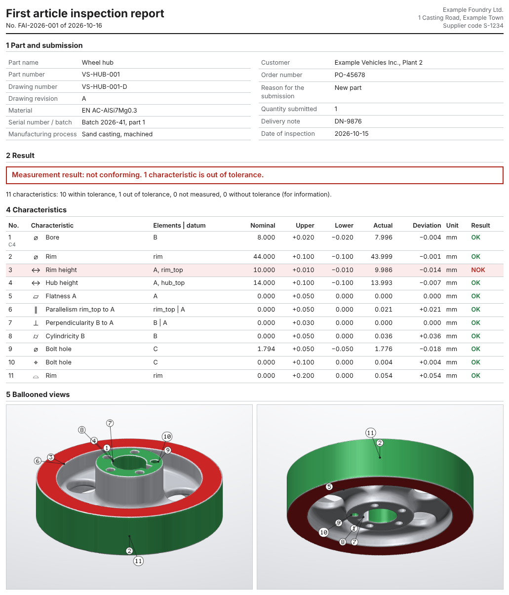
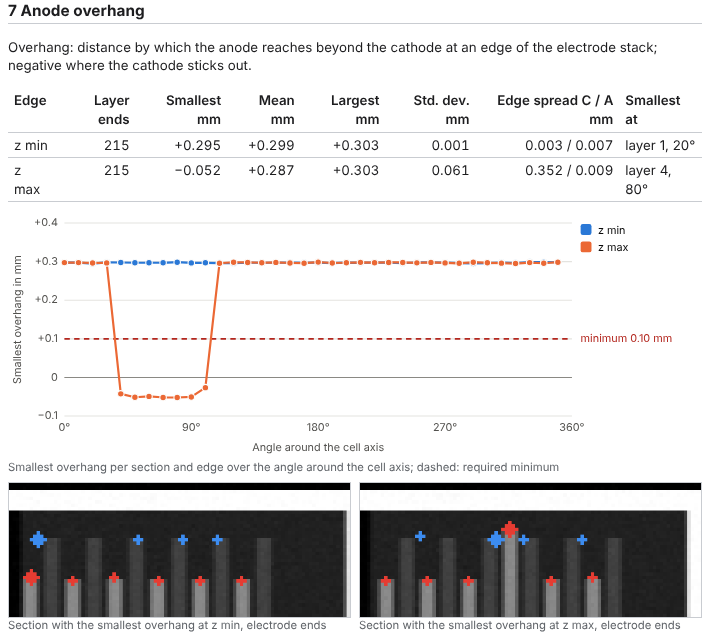

# Analyses

Each analysis is a command-line tool and an operation of a project, so it runs the same from the
shell, the [browser UI](gui.md), [Python](python.md) and an [AI assistant](mcp.md). Every tool
takes `--memory`, `--cache` and `--threads` and prints its options with `--help`. The inspection
report that evaluates the results against limits is described in [report.md](report.md).

## Surface

`vs-surface` locates the surface of the part (ISO 50 % by default) and stores it as a voxel mask
with 4 bits per voxel that encode the signed distance to the surface in steps of 1/7 voxel within
±1 voxel; everything farther is just "material" or "air". Only 8³ blocks that touch the surface
are stored, zstd-compressed per brick, so the file grows with the surface area, not with the scan:

```sh
vs-synth --part housing --voxel-size 0.1 --blur 0.05 --out housing
vs-sieve housing.raw --out housing.vsieve
vs-surface housing.vsieve --out housing.vss --stl housing.stl
```

The housing above (520 × 400 × 220 voxels) gives a 156 kB file, 588 : 1 against the 16-bit raw
volume, and its triangulated surface lies 0.033 voxels (RMS) from the analytic surface.
`voxelsieve::SurfaceMask` reads codes and distances of single voxels or regions, and converts to a
VDB level set or a mesh; `--vdb` exports the level set for Blender or Houdini. The GUI runs it
as the operation "Surface" and shows the middle slices of the mask. Format and measurements:
[ADR 0009](adr/0009-surface-distance-mask.md).



## Nominal-actual comparison

`vs-compare` compares the surface of a scan with the CAD model of the part (STL in mm). It aligns
the CAD model to the scan and measures the signed deviation of every surface point: positive where
the part has more material than nominal, negative where material is missing.

```sh
vs-compare housing.vss housing-cad.stl --out housing.compare \
    --tolerance 0.1
```

- **Alignment:** by default the principal axes of both surfaces give the coarse alignment, and a
  robust best fit (point-to-plane ICP) refines it. The CAD model may lie anywhere and in any
  orientation. `--align refine` starts the best fit from `--initial`, and `--align none` uses
  `--initial` as it is, for example when the CAD model is already in scan coordinates.
- **Outputs:**
  - `compare.json`: the transform, the fit, the mean, RMS, extremes and percentiles, the area in
    and out of tolerance, and a histogram.
  - `deviation.ply`: the scanned surface with the deviation and a colour per vertex.
  - `deviation_view_1.png`, `deviation_view_2.png`: shaded views from above and from below.
  - `cad_aligned.stl` with `--aligned-stl`: the CAD model moved into scan coordinates.
- **Internal voids:** surfaces of closed internal voids (pores) are left out by default; they
  belong to the porosity analysis.
- **Flexible parts:** `--non-rigid` bends the scanned surface onto the CAD model after the rigid
  alignment, for parts that do not keep their nominal shape in the scanner (thin sheet metal,
  plastic, rubber). The bending is elastic and smooth: thin sections bend easily, thick ones and
  the size of the part hardly, and nothing shorter than the control point spacing
  (`--non-rigid-spacing`) is bent away, so dents, bumps and wrong wall thicknesses stay
  deviations. The deviation is then measured on the bent surface; `deviation.ply` and
  `displacement_view_[12].png` show how far every point was moved, and `compare.json` keeps the
  figures of the rigid alignment alone for comparison
  ([ADR 0022](adr/0022-non-rigid-registration.md)).

On synthetic castings the fit finds the pose of the CAD model to 0.15 voxels, and it measures a
0.4 mm dent to 0.02 mm. The GUI runs the comparison as the operation "Nominal-actual comparison"
and shows the coloured surface in the 3D view as "Nominal-actual deviation". Method and decisions:
[ADR 0010](adr/0010-nominal-actual-comparison.md).



## Wall thickness

`vs-thickness` measures how thick the wall is at every point of the part's surface, without a
CAD model, and finds the regions thinner or thicker than the drawing allows:

```sh
vs-thickness housing.vsieve --out housing.thickness \
    --min-wall 2.5 --max-wall 8
```

- **Methods:** `--method ray` (default) follows the inward normal through the grey values to the
  opposite face of the wall, to a fraction of a voxel, as a calliper would. A ray that leaves the
  wall through an edge or along a rib, where the face it reaches does not lie within the search
  angle (`--search-angle`, default 30°), leaves the point unmeasured rather than reporting a length
  that is not a wall. `--method sphere` takes the diameter of the largest sphere inside the
  material that touches the point: defined everywhere, also at ribs and in corners, but small at
  convex edges by definition.
- **Pores** thin the wall they lie in: their surfaces limit the rays and spheres, but only the
  outer skin gets values (`--all-surfaces` measures the pore surfaces too).
- **Outputs:**
  - `wall_thickness.json`: area-weighted statistics (minimum, mean, percentiles, histogram), the
    share of the surface measured, and the thin and thick regions with area, extreme value and
    location.
  - `thickness.ply`: the surface in mm with the thickness and a colour per vertex.
  - `thickness_view_1.png`, `thickness_view_2.png`: views from above and from below, red for
    thin over yellow and green to blue for thick walls, magenta below the minimum, violet above
    the maximum and grey where no wall up to `--max-thickness` was found.
- **Large scans:** only the surface mesh is held in memory (`--max-triangles`); the grey values
  are read along the rays through the brick cache.
- **Against the CAD model:** `--nominal part.compare` (the output of `vs-compare`) also measures
  the nominal thickness of the aligned CAD model at every point, by the same method, and the
  deviation of the actual thickness from it: walls that came out thinner or thicker than designed,
  such as both walls around a shifted core. `thickness.ply` gets `nominal` and `deviation` per
  vertex, `thickness_deviation_view_[12].png` show it.
- **Inside the part:** `--volume-map` also writes the local thickness of every material voxel
  (the largest sphere inside the material that contains it) as the dataset `thickness_map/`,
  with statistics, regions beyond the limits and slices through the thickest spot. It finds
  material accumulations such as hot spots where a wall meets a flange, which the surface does
  not show. Material thicker than `--map-max-thickness` (default: the smallest extent of the
  part, at most 64 voxels) gets that value. Convex edges count to the wall they bound.

The GUI runs it as the operation "Wall thickness" and shows the coloured surface in the 3D view
as "Wall thickness" (after a nominal-actual comparison also against the nominal thickness) and
the thickness map as an overlay of the slice view; the report adds a wall thickness section (see
below). Method and decisions:
[ADR 0030](adr/0030-wall-thickness.md).



## Porosity analysis

`vs-porosity` finds internal pores and zones of loosened microstructure in a sieved dataset:

```sh
vs-porosity part.vsieve --out part.porosity
```

- `porosity.json`: part volume, porosity, and every pore and zone with centre, bounds and void
  volume.
- `projection_x.png`, `projection_y.png`, `projection_z.png`: the part as a grey thickness image,
  pores in red, zones in yellow.
- `porosity.vdb`: grids `pores` and `zones` in the dataset's world space, to view next to the part
  in Blender or Houdini.

Pore volumes come from the grey values, so partially filled edge voxels count with their fraction.
Zones are 8³ blocks whose grey value lies clearly below the material level at the same depth below
the surface, so cupping from beam hardening is not reported as porosity (see
[ADR 0006](adr/0006-porosity-analysis.md)). On an 830 MB synthetic scan (1025 × 775 × 525 voxels,
6 lunkers, 3 loosened zones, noise and 10 % cupping) every lunker is within 2 % of its true volume,
every zone within 2 %, and the total porosity within 1 %; the analysis takes about 30 s on 4
cores. Voxels within 3 voxels of the outside air are left out of the zone detection, so oblique
faces, fillets and bores, whose partial-volume edge cuts through the blocks, are not taken for
loosened material.
`PorosityOptions` and the `--min-pore`, `--zone-sigma` and `--zone-min` options set the detection
limits.

## Dimensional measurement and first article report

The operation `measure_dimensions` measures the characteristics of a drawing on the scanned
surface, with the CAD model placed by a nominal-actual comparison (`compare_cad` or
`compare_objects`). An inspection plan in the coordinates of the CAD model (`examples/first_article_plan.json`) names
the elements by a point on them: planes, cylinders, spheres and points are found on the CAD
model, fitted to the scanned surface by least squares, and the part is aligned on its datums
(3-2-1, RPS) or kept at the best fit. Characteristics are sizes (diameter, radius, distance,
angle, coordinate), form (flatness, cylindricity, sphericity), orientation (parallelism,
perpendicularity), position, profile and the deviation of a point, each with its balloon number,
nominal value and tolerance. The GUI method `cad_features` lists the regular geometry of a CAD
model with a picture, so that a plan can be written without a CAD system.

`first_article_report` writes the first article inspection report: a cover sheet (supplier,
customer, part, drawing and revision, reason for the submission, from
`examples/first_article_order.json`), the decision, the list of characteristics with nominal
value, tolerance, actual value and result, views of the CAD model with the characteristic numbers
as balloons in red and green, the measured elements and, when the project has them, the
nominal-actual comparison and the porosity with its acceptance limits. Like the test report it is
one HTML file from a replaceable template (`vs-report --print-first-article-template`), plus
`report.json` and `characteristics.csv`. Fits are least squares, not minimum zone; see
[ADR 0027](adr/0027-dimensional-measurement.md) for the method and its limits.



## Battery cells

`vs-battery` (operation `battery_inspection`) inspects a lithium-ion cell, cylindrical (wound
electrodes in a can) or stacked (pouch, prismatic): diameter, out-of-roundness, dents and wall of
the housing per cross-section, the core, the number and pitch of the electrode layers and gaps
between them, the anode overhang at every edge of the electrode stack layer by layer, the
unevenness of the electrode edges, and metal particles and gas voids between the layers. With
`--order examples/battery_order.json` (operation `battery_report`) it writes a test report that
assesses the cell against the requirements of the order: overhang, layer count, dimensions,
roundness, wall, gaps, particles and voids.

```sh
vs-battery --cell cylindrical --out cell --extension 3 1 0.35 40 100   # synthetic cell, defect
vs-sieve cell.raw --out cell.vsieve
vs-battery cell.vsieve --out cell_result --order examples/battery_order.json
```

The synthetic cell's fourth cathode turn sticks out at the top over 60°; the report finds it in
that layer and angle:



Cylindrical cells given as section images instead of a volume are inspected as well: a folder
or ZIP archive with a folder per cell holding `axial_images/<angle>.png` (longitudinal sections
through the axis, the right half at the angle, the left half opposite, the top row at the high
end) and `radial_images/<position mm>.png` (cross-sections). Housing and layers come from the
cross-sections, the overhang from both halves of every longitudinal section, particles and voids
from all images (operation `battery_images`). Without `--image-cell`, every cell is inspected
and `cells.csv` summarises them:

```sh
vs-battery --images scans.zip --list-cells
vs-battery --images scans.zip --out results --order examples/battery_order.json
```

The pixel size follows from the positions of the cross-sections over the height of the
longitudinal sections unless `--pixel-size` gives it.

The cell axis or stack normal must lie along a volume axis. See
[ADR 0029](adr/0029-battery-cell-inspection.md) for the method and its limits.


## Materials

`vs-segment` (operation `segment_materials`) splits a dataset into material classes by grey value,
separated at the valleys of the histogram (the operation also finds the number of materials itself
with `materials` 0), or runs a learned model (`--model part.vsm`) on the CPU tile by tile; `--truth` scores the result against a
label volume. The training scripts are in `tools/models/`. See
[ADR 0013](adr/0013-material-segmentation.md) and [ADR 0014](adr/0014-learned-segmentation.md).

```sh
vs-segment part.vsieve --out part.materials --materials 3
```

## Denoising and beam hardening

`vs-denoise` writes a denoised dataset by non-local means against the measured noise of the scan,
or by a learned model trained on the noisy scan alone; `--benchmark` compares the methods on a
synthetic scan ([ADR 0025](adr/0025-denoising.md)). `vs-beam-hardening` removes cupping and the
dark streaks between dense regions, by reprojection across the rotation axis (default) or by
depth below the surface, both estimated on a coarse level, and `--measure` only measures the cupping
([ADR 0033](adr/0033-beam-hardening-correction.md)). Both keep the part and write a new dataset.

## Fibre composites

The operation `fibre_orientation` finds the local fibre direction of a composite from
the structure tensor and groups the directions into fibre families with direction, share and
spread ([ADR 0028](adr/0028-fibre-orientation.md)). With a material segmentation, the porosity
analysis reports the pores per material, and the report takes requirements per fibre family.

## Isolating the part and regions

`isolate_part` writes a dataset without the holder or fixture the part stands in
([ADR 0026](adr/0026-isolating-the-part.md)). `define_region` saves a named region of a scan,
drawn as boxes, spheres and cylinders in the slice view or taken from a CAD model; the porosity
analysis and the wall thickness take it as `region` and report only what lies in it
([ADR 0041](adr/0041-regions-of-a-scan.md)).
