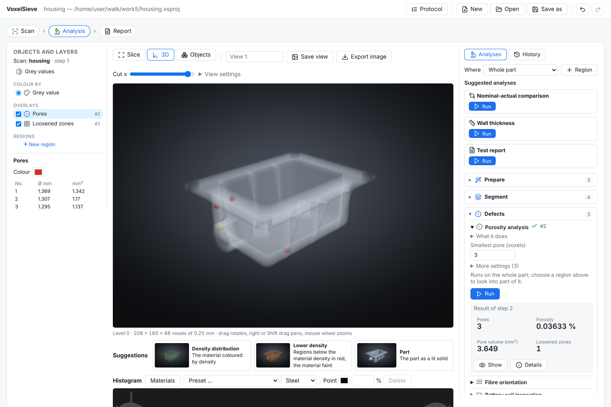
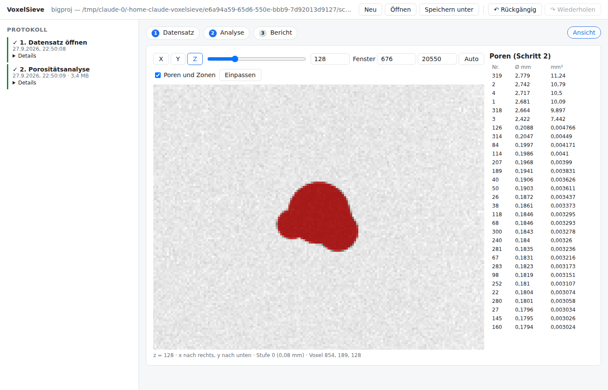
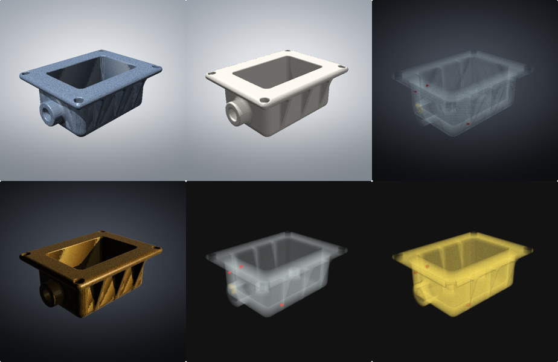
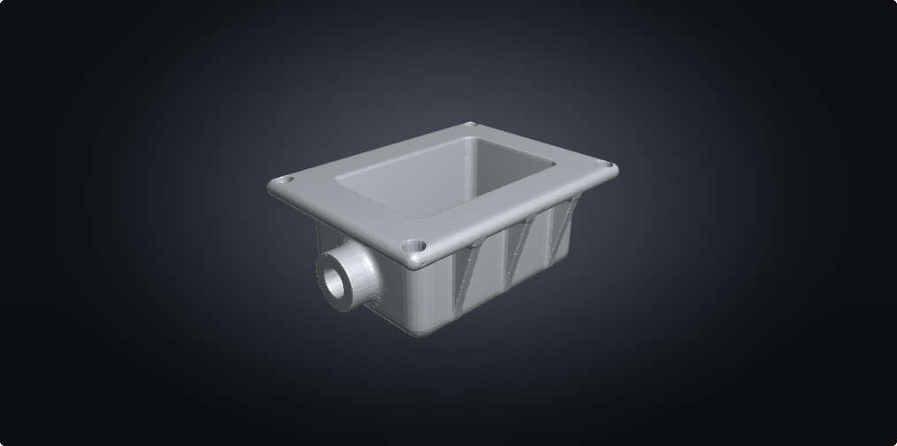
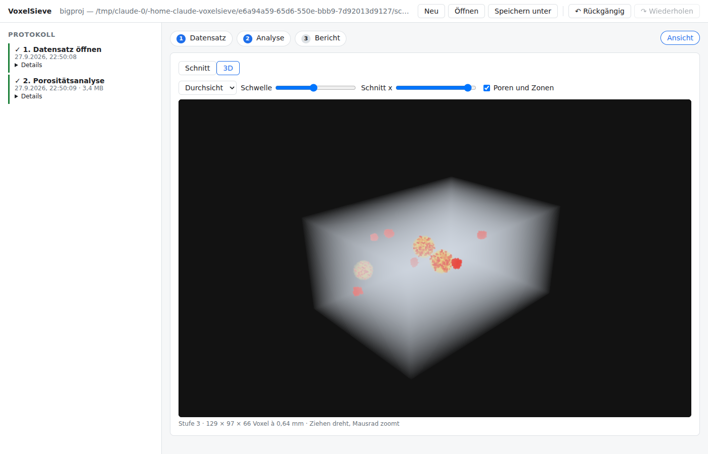
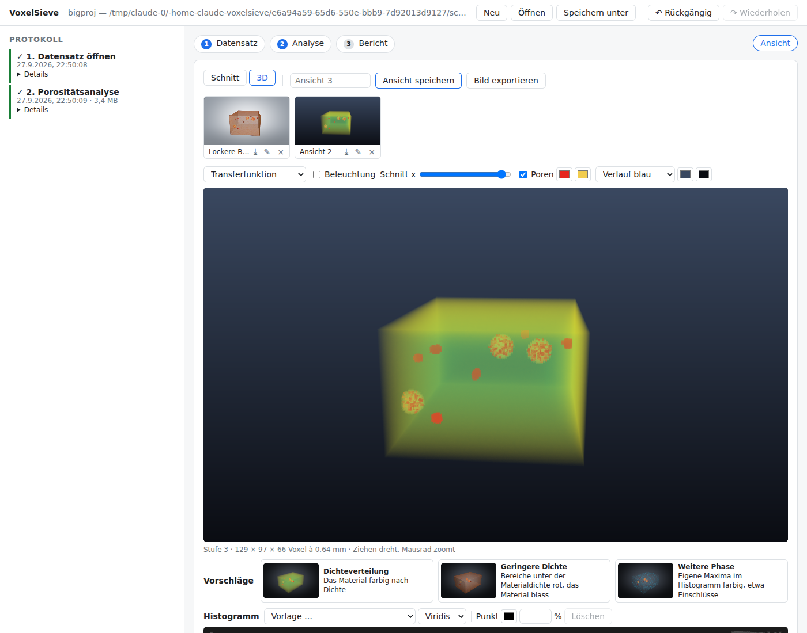
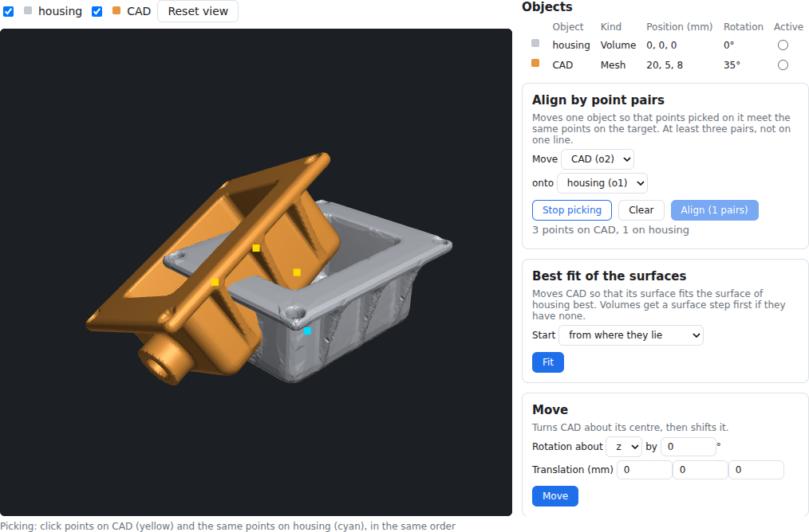
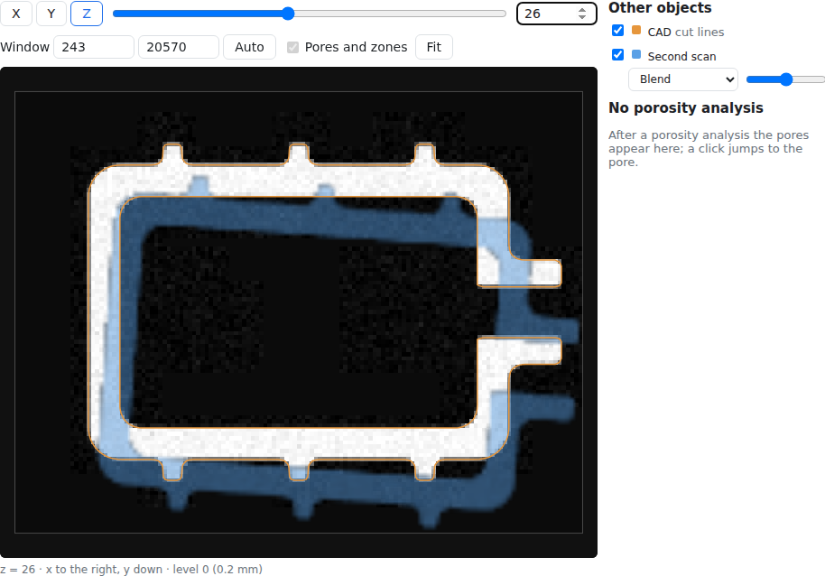

# Browser UI

`vs-gui` starts the GUI and prints its address, by default http://localhost:8410. "Open a
scan …" is all a first look takes: VoxelSieve finds out what the file is (raw, TIFF, DICOM or a
dataset; a raw file without a sidecar is read from its name or its grey values), creates a
project next to the scan, imports it and shows the part in 3D, with the analyses that suit it
beside the view (porosity, wall thickness, materials, comparison with a CAD model next to the
scan, battery cells, fibre composites, beam hardening), each started with one click ([ADR 0039](adr/0039-opening-a-scan.md)).
Detected or assumed values, such as a missing voxel size, are shown for a check first.

The analysis is one workspace ([ADR 0040](adr/0040-workspace-and-layers.md)): objects and layers on the left, the view in the
middle, the analyses in groups (prepare, segment, defects, geometry, reports and export) and the
history of all results on the right. Every result becomes a layer: the grey values are drawn as
a solid surface, translucent or as maximum intensity projection; one colouring at a time
(materials, nominal-actual deviation, wall thickness) colours the part; pores, loosened zones
and other objects are overlays to switch on and off. The report is the last stage. Every step appears in the protocol with its
parameters and results and can be undone (Ctrl+Z) and redone; the project is saved after each
step. Plugins appear next to the built-in operations.

Regions are drawn in the slice view as boxes, spheres and cylinders, added or cut out, or taken
from the inside of a CAD model, and saved under a name ([ADR 0041](adr/0041-regions-of-a-scan.md)). They show in both views and in
the layer tree, and the "Where" choice of the analyses column limits porosity and wall thickness
to one of them. The stages, layers and analyses have icons, the descriptions of the analyses are
tooltips, and the key figures of a result are tiles ([ADR 0042](adr/0042-icons-in-the-browser-ui.md)).



The view shows slices along x, y or z. It loads only the tiles on screen, from the
resolution level that matches the zoom, so it stays fast on scans of hundreds of GB. Wheel zooms,
dragging pans, the arrow keys (or Shift and the wheel) step through slices; pores are tinted red
and loosened zones yellow, and a click on a pore in the list jumps to it.



The 3D view ray-casts a coarse level of the dataset (at most 256 voxels per axis) in the browser:
"Surface" shades the part surface at a threshold dragged in the histogram, "Transfer function"
composites colour and opacity per grey value, and "Maximum intensity projection" shows the densest value
along each ray. The transfer function is edited on the histogram: click adds a control point,
drag moves it, double click removes it; each point has its own colour, or a colour map colours
every grey value between two markers dragged on the strip under the histogram. Sixteen maps
(neutral, perceptual such as Viridis, Inferno and Cividis, material looks such as Gold, Jade and
Ice, Turbo, a diverging map and an own gradient) can be reversed, and presets start from typical
settings; "Edges only" leaves surfaces and pore walls and clears the inside. Pores, zones and the
materials of a segmentation have their own colours (with palettes and, translucent, an opacity
per material), and a cut along x opens the part. The background can be a soft light, a gradient
or a plain colour.

The light has presets (headlight, studio, top light, dramatic, back light, flat) or is set by
hand: direction of the key light, which follows the camera or stays in the scene, fill and rim
light, ambient light, highlights, soft shadows and ambient occlusion ([ADR 0043](adr/0043-colours-light-and-video.md)). "Looks" set
curve, colours, light and background in one click: studio, clay, glass, gold, X-ray and glow.
"Record video" makes a video of the view as MP4 (WebM in Firefox) up to 3840 × 2160: a
turntable, a swing, an orbit, a sweep of the cut into the part, a zoom or a flight through the
saved views. The browser encodes it; nothing is installed for it. Drag turns the part,
right or shift drag moves it, the wheel zooms. Close up, the view loads the part nearest the
camera again at the level a pixel there needs (`/api/volume` with a region) and fades it in over
the coarse volume, so the resolution grows where you look.



"Extracted surface" shows only the surface from a run of the operation "Surface", as a
triangle mesh at full resolution rather than the coarse level. Flat regions get larger triangles,
and a surface that would exceed the triangle budget (`GET /api/surface?max_triangles=`, default
1.5 million) is resampled at twice the voxel size until it fits. The cut along x opens it too.



When a volume is loaded, the view suggests two or three renderings from its histogram, each with a
small picture: the density spread of the material, densities below the material (pores,
loosened structure) and further peaks such as inclusions, or else the part as a solid body.



The project remembers how it was shown: stage, slice, zoom and window, camera, transfer function,
colours and background come back when it is opened again. "Save view" keeps the current
view under a name with a picture in the project (`views/<id>.png`); a click on it shows it again,
and "Export image" downloads the picture. Views are presentation, not processing, so they are
not steps and undo leaves them alone.



A project can hold several objects: scans and CAD models (STL) in one global coordinate system,
each with its pose ([ADR 0018](adr/0018-multiple-objects-and-alignment.md)). The view "Objects" shows them where they lie, each in its colour.
They are aligned by steps that apply in order: "Move" by hand, "Align by point pairs" with points
clicked on both objects, and "Best fit of the surfaces" (from where they lie, or from the
principal axes for objects far apart). "Nominal-actual comparison" then measures a scan against a
CAD model or another scan where both lie; its result shows in the 3D view and the report like that
of `compare_cad`. Over MCP, `view_objects` renders the scene as a picture, with `materials` each
material of a segmented volume as a surface in its colour. The slice view shows
the other objects in the slice of the shown volume: other scans blended in their colour or as a
checkerboard, CAD models as their cut lines.

When a scan shows more than the part, such as the holder it stands in, "Isolate part"
(`isolate_part`) writes a dataset without voxels outside a region (a box in voxels) and without
every object but the largest ones, so segmentation, porosity and volumes see the part alone ([ADR 0026](adr/0026-isolating-the-part.md)). Objects that touch are separated by eroding them apart and growing them back
(`separate_voxels`), and cut planes and a cylinder cut away what a box cannot. The material
segmentation finds the number of materials itself with `materials` 0, one per peak of the
histogram or per shoulder and tail a Gaussian mixture finds, which the method `histogram` shows
with its suggestion and the share of voxels at class boundaries; `view_slice` with
`preview_thresholds` previews the classes. "Material meshes" (`material_meshes`) exports the
surface of each material as an STL and adds it as an object in the material's colour. "Measure
objects" (`measure_objects`) measures each connected object of a material, or the enclosed air
(material 0, such as a swim bladder or a cavity): volume, surface area, centroid, bounding box
and lengths along its principal axes and along a given axis, as a table (`objects.csv`).





```sh
vs-gui --project /data/casting.vsproj --plugins build/release/plugins
```

The server listens on 127.0.0.1 only. The address it prints carries an access token that changes
with every start; requests without it are refused. The connection is not encrypted, so do not
expose the server to a network.
