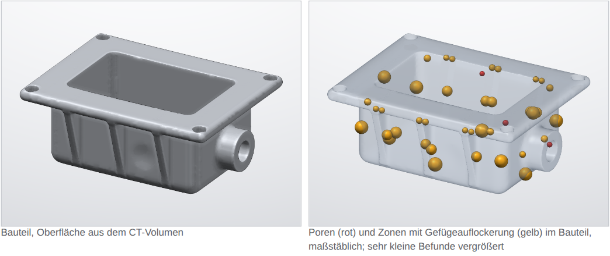
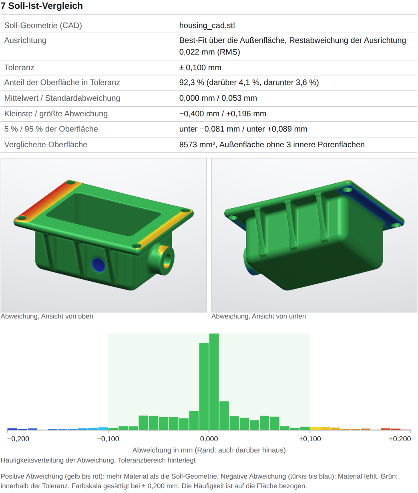

# Inspection report

`vs-report` runs the porosity analysis, evaluates it against the acceptance limits of an
inspection order and writes a test report as one self-contained HTML file (print to PDF from the
browser):

```sh
vs-report part.vsieve --order examples/inspection_order.json \
    --out part.report
```

The report is structured after the report contents of ISO/IEC 17025 (7.8) and the CT test
report of ISO 15708-3: order, part, method, scan settings, analysis parameters and
detection limits, results with projection images and pore list, evaluation and approval. The
inspection order (`examples/inspection_order.json`) supplies what the scan cannot know, such as
the customer, the part number or the tube voltage; missing mandatory fields are marked
"not given" in the report and printed as warnings.

Acceptance follows the schemes of BDG P 202 and BDG P 203: per inspection zone optional limits on
the largest pore extent, the number of pores above a size, the porosity, and whether loosened
microstructure is allowed (P 202), and on the porosity of the whole part (PG), of the zone (PROI)
and of a reference volume placed where the porosity is highest (PV), on pore volume, enclosing and
equivalent diameter, sphericity, compactness, the gap between pores and the distance to the
surface, with pores to disregard (P 203). A zone takes the porosity key as written on the drawing
(`"porosity_key": "BDG P203 - PV7/ Øp3/ UØp0,3"`) or the same limits as fields. The limits
come from the drawing or the customer.

The sections of an order that hold limits (`acceptance`, `wall_thickness`, `fibres`, `battery`)
take only the keys that are evaluated: a misspelt limit such as `max_pore_size` is an error that
names `max_pore_size_mm`, not a limit that is silently left out, and so is a zone without any
limit. The other sections describe the inspection for the report and may hold anything a template
shows. `schema/inspection_order.schema.json` lists every key with its meaning and
`schema/inspection_plan.schema.json` those of the plan of a dimensional measurement; an
editor that knows JSON Schema completes and checks the files with them.

A zone is the whole part or a region: the union of boxes, spheres, cylinders and closed meshes
(STL), minus excluded ones. In the GUI a region can name a mesh object of the project, such as a
region drawn on the CAD model, and follows its pose; `inspection_regions` shows the regions as
objects in the views. `examples/inspection_order_p203.json` uses all of it (ADR 0032):

```json
{ "name": "Zone A (sealing face, machined)",
  "porosity_key": "BDG P203 - Z3/ Øp0,5/ da0,3/ UØp0,2",
  "region": { "include": [{ "box_mm": [[0, 0, 4], [8, 7, 6]] }],
              "exclude": [{ "cylinder": { "from_mm": [4, 3.5, 3], "to_mm": [4, 3.5, 6],
                                          "radius_mm": 0.8 } }] } }
```

With `--surface part.vss` (from `vs-surface`) the report shows the part and its pores in 3D: the
part as glass with pores in red and loosened zones in amber, true to scale. With
`--comparison part.compare` (from `vs-compare`) it adds the nominal-actual comparison: the key
figures, the coloured deviation from above and from below, and the histogram of the deviation.
With `--wall-thickness part.thickness` (from `vs-thickness`) it adds the wall thickness:
statistics, coloured views, histogram and the thin and thick regions. A `wall_thickness` section
in the order sets the limits, and `max_area_below_min_mm2` tolerates small thin spots such as
sharp edges instead of judging the single thinnest point. When the analysis wrote a thickness
map (`--volume-map`), the report shows it too, and `max_mm` also judges the thickest spot inside
the part. With a CAD model (`--nominal`), `nominal_tolerance_mm` judges the deviation from the
nominal thickness, and `max_area_outside_nominal_mm2` tolerates small areas beyond it:

```json
"wall_thickness": { "min_mm": 2.5, "max_mm": 8.0, "max_area_below_min_mm2": 5.0,
                    "nominal_tolerance_mm": 0.4, "max_area_outside_nominal_mm2": 5.0 }
```

In the GUI, the report step takes the latest surface, comparison and wall thickness of the
project when there are any. The views are rendered on the CPU (`voxelsieve/render.hpp`), so no GPU is needed.

For fibre composites and other parts of several materials, the report step in the GUI also takes
the material segmentation (materials with grey values, volume and share, slices coloured by
material) and the fibre orientation (fibre families with direction, share and spread, slices
coloured by direction). A `fibres` section in the order sets requirements per fibre family, each
compared with the measured family closest to its nominal direction:

```json
"fibres": { "families": [
  { "name": "Warp", "direction": [0, 0, 1], "tolerance_deg": 5,
    "min_share_percent": 40, "max_share_percent": 60 } ] }
```





The layout is a template: `vs-report --print-template > my_template.html` prints the built-in one,
`--template my_template.html` uses your own. Templates use a Mustache subset (`{{name}}`,
`{{#list}}...{{/list}}`, `{{^name}}...{{/name}}`); `report.json` in the output shows all available
data. See [ADR 0007](adr/0007-inspection-report.md).
