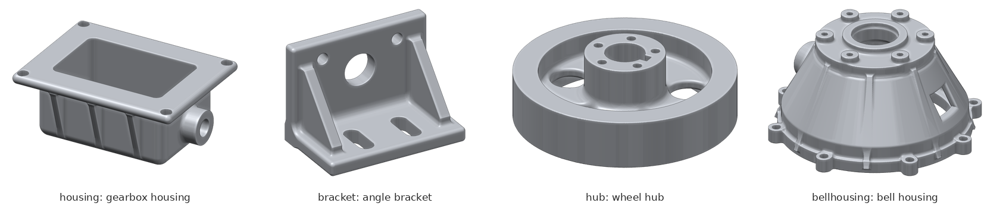

# Synthetic scans from STL

`vs-synth` turns a closed STL mesh (in mm) into a raw CT volume with artificial defects, noise and
artefacts, plus a JSON sidecar with the ground truth. It is the test bed for defect analyses.

```sh
vs-synth part.stl --out part --voxel-size 0.05 \
    --lunker 5 --loosening 2 --noise 500 --cupping 0.1 --rings 8
vs-sieve part.raw --out part.vsieve
```

- `--lunker N`: shrinkage cavities, irregular unions of overlapping spheres.
- `--loosening N`: zones of loosened microstructure (Gefügeauflockerung), many small pores near or
  below the voxel size up to `--loosening-porosity` (default 5 %).
- `--noise`, `--cupping` (beam hardening), `--rings` (ring artefacts around the z axis).
- `--blur MM`: unsharpness of the imaging chain, a Gaussian point spread function with this sigma.
- `--hot-spots` places lunkers and loosened zones in the thickest sections, where a casting
  solidifies last, instead of anywhere with room; `--lunker-spread F` varies the lunker sizes down
  to (1 - F) times `--lunker-radius`.
- `--box X Y Z` uses a box instead of an STL file; `--part housing|bracket|hub|bellhousing` uses a
  sample casting with walls, ribs, bosses, bores and fillets (`--scale`, `--stl` writes its mesh).



`part.json` lists every defect with its position, size and void volume, and the total porosity.
The grey values carry the void volume exactly, even for pores much smaller than a voxel (see
[ADR 0005](adr/0005-synthetic-scans-from-meshes.md)). The scan is computed on demand and streamed to
disk: 1040 × 840 × 640 voxels (1.1 GB) with 15 defects take 41 s on 4 cores.

## The bell housing of the README

The porosity images in the README and on the website come from one synthetic scan of the sample bell housing,
765 × 765 × 380 voxels of 0.1 mm (445 MB), with the shrinkage cavities and loosened zones where a
casting solidifies last: `vs-synth --part bellhousing --voxel-size 0.1 --hot-spots --lunker 12
--lunker-radius 0.9 --lunker-spread 0.6 --loosening 3 --loosening-radius 1.5 --noise 500
--cupping 0.08 --blur 0.07 --seed 12`. Every lunker volume is found within 2 % of the ground
